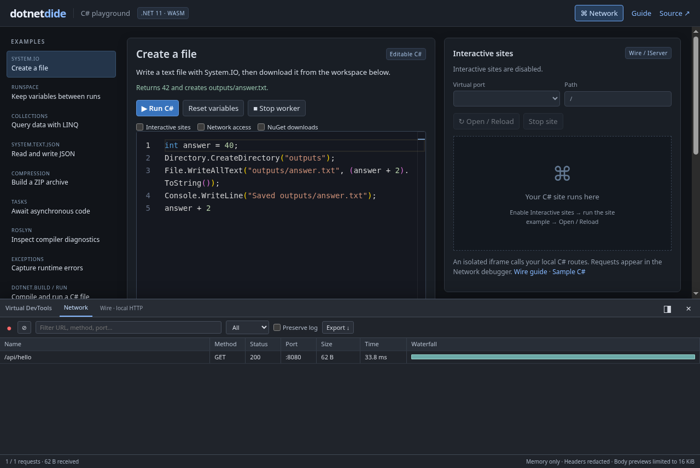
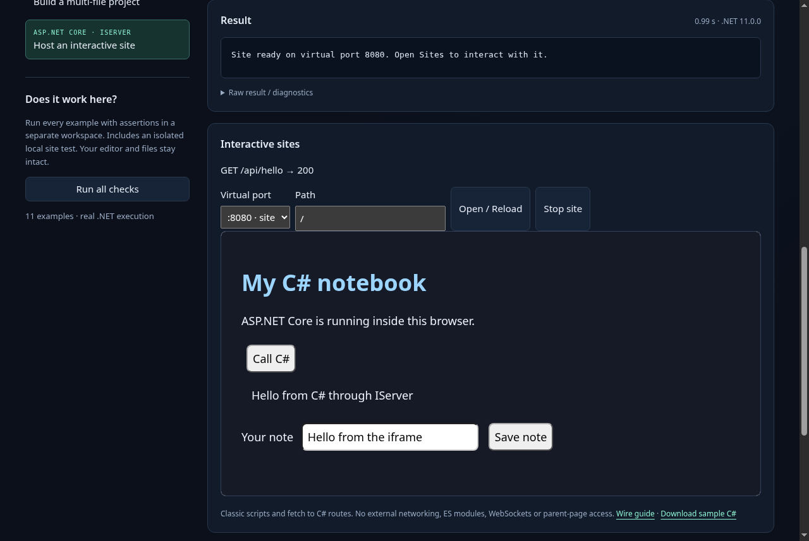

# dotnetdide

**[Try it now — C# playground](https://maxfridbe.github.io/dotnetdide/)** ·
Editable examples, downloadable files and real browser runtime checks.

[](https://maxfridbe.github.io/dotnetdide/)

A .NET 11 browser runspace with persistent C# submissions and a shared virtual
filesystem, inspired by [WasmSharp](https://github.com/JakeYallop/WasmSharp).

**No npm, Node.js, TypeScript build, Comlink, or Playwright dependencies.** The
compiler, runspace, filesystem and tests are .NET. Plain browser JavaScript only
loads the runtime, carries worker messages and presents the small demo.

## What works

- Compile and execute C# inside the browser with Roslyn on .NET 11 WebAssembly.
- Keep variables, imports, types and functions between submissions; await async code.
- Capture stdout, stderr, expression values, compiler diagnostics and runtime errors.
- Read/write text and binary files from either `System.IO` or the browser `FS` API.
- List, inspect, rename and remove files; preserve empty directories in snapshots.
- Export/import JSON workspace snapshots for host-managed persistence.
- Isolate each runspace in its own worker. Terminate a worker even during an infinite loop.
- Reset variables while retaining files, or start a fresh worker for a full reset.
- Build workspace C# files and supported SDK-style projects into downloadable DLL/PDB files.
- Run compiled programs with arguments, async entry points, build logs and captured output.
- Host ASP.NET Core middleware/routes on virtual ports with `DotnetDide.Wire` and an isolated interactive iframe.

## Build and run saved C# programs

Inside a submission, use the supplied `Dotnet` helper:

```csharp
File.WriteAllText("hello.cs", "Console.WriteLine(args[0]);");
var build = Dotnet.Build("hello.cs"); // DLL + portable PDB, without executing
var run = await Dotnet.Run("hello.cs", new[] { "Hello from a saved program" });
Console.WriteLine(run.ExitCode);
```

`Dotnet.Build()` discovers the project in the current directory, or compiles its
C# files when there is no project. `await Dotnet.Run("app/Demo.csproj")` compiles
and runs a supported SDK-style project. Logs and diagnostics appear in the output;
generated files appear in the download list. Inspect `build.Success`/`run.Success`.
This uses Roslyn and a documented project subset; it does not run MSBuild or restore
PackageReference items; use the separate Nuget.Load API for additional managed libraries. See **[llm.md](llm.md)** for default imports, available namespaces,
result fields, project support and guidance for generating programs.

## Interactive sites

[](https://maxfridbe.github.io/dotnetdide/)

Enable **Interactive sites**, select **Host an interactive site** in the playground,
run it, and open port 8080. Its HTML/JavaScript calls C# routes and saves a downloadable
note. `Wire.ListenAsync` implements ASP.NET Core `IServer` without sockets, returns
immediately, and keeps the site running after a saved program exits.

This is a separate permission, off by default (`siteAccess: true` in the SDK).
Network and NuGet permissions are independent. The preview supports classic scripts,
CSS, media and `fetch`; it has no parent storage access, external requests, module
imports or WebSockets. See the **[Wire guide](docs/wire.md)** for runnable `.cs` and
`.csproj` examples, embedding, limits and the tested .NET 11 RC2 JSON workaround.

## Available .NET libraries

See the [full runtime assembly list](docs/runtime-assemblies.md) for the libraries
included in the pinned .NET 11 build: **215 assembly references**, including
**165 `System.*` assemblies**. They are already referenced by the C# compiler;
use their namespaces directly in submissions without a separate loading step.

The inventory includes collections, LINQ, JSON, regular expressions, XML,
compression, HTTP and `System.IO`. File operations use the same virtual filesystem
as the browser `FS` API. Assembly presence does not guarantee browser support for
every API; native OS facilities may throw `PlatformNotSupportedException`.
Media libraries are bundled by default: StbImageSharp/StbImageWriteSharp,
NAudio.Core and Concentus/Oggfile. Generate PNG/JPEG, WAV and Ogg Opus files
without installing anything. Additional compatible managed packages can be loaded
with `await DotnetDide.Nuget.Load("Newtonsoft.Json", "13.0.4")` when the host enables
`nugetAccess`. Use the loaded types in the next submission. Downloads happen in
the browser and exact-version archives persist in Cache Storage.

See **[media examples, NuGet permission and caching](docs/media-and-packages.md)**.
The bundled defaults remain available even when NuGet access is disabled.

## Browser playground

The [GitHub Pages testing page](https://maxfridbe.github.io/dotnetdide/) includes
examples for persistent variables, LINQ, JSON, System.IO, ZIP archives, async code,
compiler diagnostics, runtime exceptions and file/project compilation with `Dotnet.Build`
and `await Dotnet.Run`. Select an example, edit it and click
**Run C#** (or Ctrl/⌘ + Enter). The variables example has two steps to run in order.
**Run all checks** verifies every example in a separate workspace without changing
your interactive session. Expected compiler/runtime errors count as passing checks.

The editor uses Monaco with C# syntax highlighting, line numbers, bracket matching,
find/replace, undo/redo and Roslyn diagnostics after each run. Ctrl/⌘ + Enter runs
the current code; Ctrl+M toggles whether Tab indents or moves focus. C# semantic
IntelliSense and automatic formatting are not provided by this integration.
Monaco 0.57.0 is bundled as prebuilt browser assets (including its workers), so the
site has no editor CDN dependency and still needs no Node.js/npm build step.
If Monaco fails to load, a plain text editor remains available.

The first run downloads approximately 40 MiB of runtime/compiler assets. Files and
variables are in memory; export a files snapshot before refreshing. You can restore
files from that snapshot, but variable state is not serialized.

Pushes to `master` build and test the actual WebAssembly site before deploying it
to GitHub Pages. In repository **Settings → Pages → Build and deployment**, select
**GitHub Actions** as the source. The same page can be served locally below.

## Build and test

Install the SDK pinned in `global.json`: **11.0.100-rc.2.26504.105**. This is a
.NET 11 release candidate; the pin is intentional. Official downloads:
[.NET 11](https://dotnet.microsoft.com/en-us/download/dotnet/11.0).

```sh
dotnet workload install wasm-tools
dotnet restore DotnetDide.slnx --locked-mode
dotnet test tests/DotnetDide.Core.Tests --no-restore
dotnet publish src/DotnetDide.Browser -c Release -o artifacts/site --no-restore
CHROME_BIN=/path/to/chrome dotnet test tests/DotnetDide.Browser.Tests --no-restore
dotnet run --project tools/DotnetDide.Server -- artifacts/site/wwwroot 5080
```

Open **http://localhost:5080** to try the C# runspace. Any static HTTPS host can
serve `artifacts/site/wwwroot`; no application server is needed for execution.
Subdirectory hosting is covered by browser tests. The included .NET server is
only a local static-file development server.

Browser tests launch an installed Chrome/Chromium and speak DevTools Protocol
using .NET `ClientWebSocket`. They fail if the browser or published files are
missing; they never silently substitute a mock runtime.

## Versioned ZIP releases

[Download browser/embedding releases](https://github.com/maxfridbe/dotnetdide/releases).
Successful `master` workflows publish `dotnetdide-yy.mmdd.nn.zip` and a SHA-256
checksum, using the UTC date and a two-digit daily sequence starting at `01`
(for example `26.1019.01`, then `26.1019.02`). Release jobs serialize version
allocation and tag the exact tested commit. Pull requests do not publish releases.

The ZIP contains `wwwroot/` with the complete tested runtime/playground, plus
README, integration/LLM guides, namespace/assembly inventories, license notices
and `release.json` with the version and commit. Extract it and serve `wwwroot/`
over HTTPS or localhost; no build tools are needed to use the published archive.

To package a local published build without uploading anything:

```sh
dotnet publish tools/DotnetDide.Relay -c Release -o artifacts/relay
bash .github/scripts/package-release.sh 26.1019.01
```

## Embed

```js
import { loadDotnetdide } from './dotnetdide.js';

const runtime = await loadDotnetdide();
await runtime.runCSharpAsync('int answer = 40;');
const result = await runtime.runCSharpAsync('answer + 2');
console.log(result.value); // "42"

await runtime.FS.mkdir('data');
await runtime.FS.writeFile('data/input.txt', 'hello');
await runtime.runCSharpAsync(`
    File.WriteAllText("data/output.txt", File.ReadAllText("data/input.txt").ToUpperInvariant());
`);
console.log(await runtime.FS.readFile('data/output.txt', { encoding: 'utf8' }));

const snapshot = await runtime.exportWorkspace();
// Store snapshot with your session (IndexedDB, a downloaded file, etc.).
await runtime.reset(); // clears C# variables, keeps files
runtime.terminate();  // discards the entire worker

const resumed = await loadDotnetdide();
await resumed.importWorkspace(snapshot); // files restored; variables are new
```

All browser `FS` calls are asynchronous because their implementation is in .NET
inside the worker. Paths are relative to `/home/dotnetdide` (the C# working
directory), or absolute within that directory. Text uses UTF-8; binary reads
return `Uint8Array`.

See [integration.md](integration.md) for the API and failure semantics, and
[docs/tdd.md](docs/tdd.md) for the tests-first development record.

## Foundation scope

This is an initial runspace SDK, not a replacement for all Pyodide features.
There is no full MSBuild/NuGet project restore, language server, debugger, stdin bridge or
automatic IndexedDB persistence yet. Native processes and platform-specific
.NET APIs are unavailable in browser WebAssembly. Only files are serializable;
a running C# object graph is not a session snapshot.

The runtime is untrimmed and interpreted so dynamically compiled programs can
use standard library APIs. The runtime/compiler assets are about 40 MiB before HTTP compression, plus
editor assets and documentation; size optimization follows compatibility tests. Loaded submission
assemblies cannot be unloaded individually: replace the worker to reclaim them.

Workspace paths are bounded by the file API, but arbitrary C# can access other
files in its browser runtime and use browser-available network APIs. The worker
is an isolation/lifecycle boundary, not a security boundary for mutually
untrusted code. The native core test library executes trusted test code only.

## Layout and provenance

- `src/DotnetDide.Core`: Roslyn submission chain, results, System.IO workspace.
- `src/DotnetDide.Browser`: .NET WebAssembly exports and browser entry points.
- `tests/DotnetDide.Core.Tests`: native semantic and filesystem tests.
- `tests/DotnetDide.Browser.Tests`: real Chromium/WASM acceptance, driven by .NET.
- `tools/DotnetDide.Server`: optional .NET static development server.

WasmSharp's runtime-assembly metadata and in-memory compiler approach provided
the starting point; this repository supplies the persistent runspace and filesystem
layer. See [NOTICE](NOTICE) for the upstream commit and attribution. Apache-2.0.

## Browser network access

Network access defaults to **off**. The host opts in with
`loadDotnetdide({ networkAccess: true })` and can change it while idle with
`await runtime.setNetworkAccess(false)` without losing variables or files. This gates new HTTP requests; use
`runtime.terminate()` to stop outstanding requests and code immediately.
The setting controls worker `fetch` (including ordinary `HttpClient`), XHR,
WebSocket, EventSource and WebTransport. Runtime assets load during startup
before user code runs. Model/API requests made by the embedding page are separate.

```csharp
var text = await Dotnetdide.Net.GetStringAsync("https://example.org/data.txt");
var bytes = await Dotnetdide.Net.GetBytesAsync("https://example.org/image.png");
File.WriteAllBytes("image.png", bytes);
var reply = await Dotnetdide.Net.PostJsonAsync("https://example.org/api", new { answer = 42 });
// More methods: HeadAsync, OptionsAsync, DeleteAsync, PostAsync, PutAsync, PatchAsync,
// PostFormAsync and RequestAsync(method, url, content, options).
// Custom headers/fetch settings: SendAsync(request, new Dotnetdide.BrowserRequestOptions { Credentials = "omit" }).
// Async stream: OpenReadAsync(url). Save directly: DownloadFileAsync(url, "result.csv").
// Dispose the returned HttpResponseMessage; GetString/GetBytes/PostJson check HTTP status.
```

Use the exact capitalization `Dotnetdide.Net`. `System.Net.Http` is available
with an explicit `using` in scripts. Await network I/O. Direct HTTP obeys destination CORS and browser
mixed-content rules. The host can configure `relay: { endpoint, token }` for an
optional native .NET HTTP relay with SOCKS5 support; ordinary `HttpClient` uses it
too. The relay is included in release ZIPs under `relay/`. See
[HTTP methods, browser options, relay and Tor setup](docs/networking.md).
`bridges.torproject.org` supplies Tor bridge addresses; it is not a proxy endpoint.
Raw `System.Net.Sockets` and `HttpClientHandler.Proxy` remain unsupported in WASM;
`Net.OpenReadAsync` exposes HTTP as an async `System.IO.Stream`.
Native .NET runspace hosts must supply their own network policy.

This switch is a capability control, **not a hostile-code security sandbox**:
arbitrary JS interop/dynamic module imports can reach browser APIs outside these
wrappers. Run trusted code, keep credentials out of runspaces, and enforce network
isolation at the embedding origin/CSP layer when executing untrusted code.
